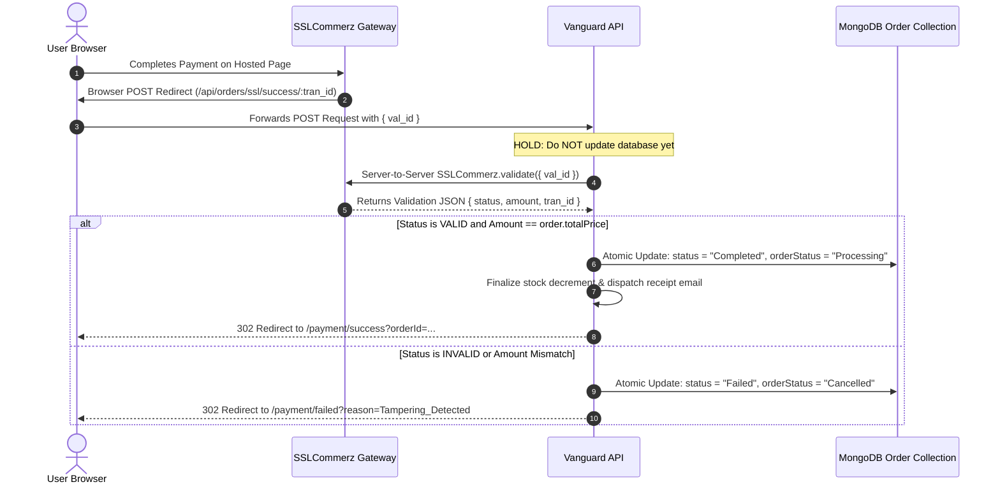

# Security Policy & Architecture Guide: Vanguard Platform

> **Status:** Active / Production-Enforced  
> **Last Audit & Hardening:** November 2026  
> **Security Baseline:** OWASP Top 10 (2021), CWE/SANS Top 25, Shift-Left DevSecOps  

---

## 1. Security Architecture Overview

The Vanguard E-Commerce platform implements a multi-tiered Defense-in-Depth architecture across five core layers:

```
┌────────────────────────────────────────────────────────────────────────┐
│ 1. EDGE LAYER (Next.js App Router / Edge Middleware)                   │
│    - Next.js Proxy/Middleware token inspection for /admin routes       │
│    - Strict SameSite=Lax, Secure cookie session propagation            │
│    - Security headers (HSTS, CSP, X-Frame-Options, X-Content-Type)     │
└───────────────────────────────────┬────────────────────────────────────┘
                                    │
┌───────────────────────────────────▼────────────────────────────────────┐
│ 2. INGRESS & NETWORK LAYER (Express 5 / Helmet / CORS)                 │
│    - Strict origin allowlist (No 'null' or unauthenticated reflection) │
│    - Global rate limiting via Redis store (express-rate-limit)         │
│    - 2MB body payload parsing limit (DoS mitigation)                   │
└───────────────────────────────────┬────────────────────────────────────┘
                                    │
┌───────────────────────────────────▼────────────────────────────────────┐
│ 3. APPLICATION & BUSINESS LOGIC LAYER                                  │
│    - Server-to-server payment gateway validation (SSLCommerz validate) │
│    - Strict identity separation (JWT req.user._id vs sanitized guestId)│
│    - Single-use hashed reset tokens (SHA-256) with 15-minute TTL       │
│    - File system sandbox containment (path.resolve upload boundary)    │
│    - External HTTP SSRF whitelist (res.cloudinary.com only)            │
└───────────────────────────────────┬────────────────────────────────────┘
                                    │
┌───────────────────────────────────▼────────────────────────────────────┐
│ 4. PRESENTATION & CLIENT LAYER (React 19 / DOMPurify)                  │
│    - DOMPurify HTML sanitization for dynamic user/blog content         │
│    - Elimination of cleartext JWT persistence in localStorage          │
│    - Rel="noopener noreferrer" enforcement on all outbound links       │
└───────────────────────────────────┬────────────────────────────────────┘
                                    │
┌───────────────────────────────────▼────────────────────────────────────┐
│ 5. DATA VAULT LAYER (MongoDB / Mongoose 9 / Redis)                     │
│    - Authenticated encryption at rest (AES-256-GCM + 16-byte Auth Tag) │
│    - Sensitive credential masking on administrative API surfaces       │
│    - Password hashing using bcryptjs (salt rounds = 10)                │
└────────────────────────────────────────────────────────────────────────┘
```

---

## 2. Threat Model & Mitigation Matrix (STRIDE)

| STRIDE Category | Threat Description | Attack Vector | Vanguard Engineered Mitigation |
| :--- | :--- | :--- | :--- |
| **Spoofing Identity** | Attacker impersonates a customer or admin to hijack orders or dashboard | Spoofing `x-guest-id` header with a victim's MongoDB ObjectId | `getMyOrders` and `getOrderById` enforce strict identity typing: registered lookups strictly bind to verified JWT `req.user._id`. Guest lookups require regex-sanitized tokens and `isGuest: true`. |
| **Tampering With Data** | Client manipulates payment amount or status to complete unpaid orders | Calling `POST /api/orders/ssl/success/:tran_id` with fake parameters | Mandatory server-to-server verification via `sslcz.validate({ val_id })`. Checks `status === "VALID"` and confirms paid amount equals `order.totalPrice` within a \$0.01 tolerance before updating DB. |
| **Repudiation** | User denies performing high-risk actions (password reset, payments) | Replaying or intercepting unhashed reset links | Reset tokens are generated with 32 bytes of cryptographic entropy, stored exclusively as SHA-256 hashes, limited to 15-minute single-use lifetimes, and never returned in API payloads. |
| **Information Disclosure** | Leakage of API keys, SMTP credentials, or cleartext customer tokens | Public calls to `/api/settings` or inspectable `localStorage` | Public allowlist (`PUBLIC_BRANDING_KEYS`, `PUBLIC_MARKETING_KEYS`) filters unauthenticated output. Secrets are masked (`••••••••••••`) for non-superadmin roles. JWTs migrated to `SameSite=Lax` cookies. |
| **Denial of Service** | Resource exhaustion via large payloads or file traversal deletion | Uploading 50MB JSON bodies or path traversal in `deleteImage` | Express JSON body parser restricted to 2MB. `deleteImage` strictly enforces root boundary containment (`fullPath.startsWith(UPLOADS_BASE_DIR)`), aborting traversal sequences. |
| **Elevation of Privilege** | Unauthenticated user opens admin dashboard or edits roles | Navigating directly to `/admin` routes or modifying client state | Next.js Edge Middleware inspects `vanguard_auth_token` before routing to `/admin/*`, redirecting invalid/missing sessions before client bundles load. RBAC middleware gates all API actions. |

---

## 3. Cryptographic Standards & Key Management

### 3.1 Encryption Algorithm
- **Cipher:** `aes-256-gcm` (Galois/Counter Mode).
- **Initialization Vector (IV):** 12-byte cryptographically secure random nonce (`crypto.randomBytes(12)`). Never reused.
- **Authentication Tag:** 16-byte (128-bit) integrity tag (`cipher.getAuthTag()`).
- **Ciphertext Format:** Hexadecimal string in format: `iv:authTag:ciphertext`.

### 3.2 Key Derivation & Environment Enforcement
- Production startup strictly requires `ENCRYPTION_KEY` in environment variables with at least 32 bytes of entropy.
- The binary key is derived via `crypto.createHash('sha256').update(process.env.ENCRYPTION_KEY).digest()`.
- Legacy ciphertext (2-part format `iv:ciphertext` generated with CBC) is supported in read-mode to ensure zero-downtime migration, with warnings logged to migrate to GCM.

---

## 4. Payment Gateway Verification Protocol

All commercial transaction completions (SSLCommerz, bKash) must follow the synchronous verification lifecycle:



---

## 5. Secure Coding Rules for Developers

When contributing new modules or endpoints to this codebase, developers must adhere to the following mandatory standards:

1. **Authentication & Identity:**
   - Never extract user identity from client headers (`x-user-id`, `x-guest-id`) when authenticated via JWT. Always use `req.user._id`.
   - Never store tokens or PII in browser `localStorage`. Use `HttpOnly`, `SameSite=Lax`, `Secure` cookies.

2. **File System Operations (`fs`):**
   - Never pass untrusted user input directly into `path.join()`.
   - Always resolve against an absolute base directory using `path.resolve()` and verify boundary containment:
     ```javascript
     const safePath = path.resolve(BASE_DIR, sanitizedSubPath);
     if (!safePath.startsWith(BASE_DIR + path.sep)) {
       throw new Error("Access Denied: Path escapes sandbox.");
     }
     ```

3. **External Requests & SSRF Prevention:**
   - Outbound HTTP requests (e.g. image fetches, webhooks) must validate target URLs against an explicit hostname allowlist.
   - Disallow loopback (`127.0.0.1`, `localhost`), link-local (`169.254.169.254`), and RFC 1918 private subnets.

4. **DOM Rendering & XSS:**
   - Avoid `dangerouslySetInnerHTML`. If rich HTML rendering is required (e.g., blog posts), wrap content in `DOMPurify.sanitize()` with an explicit tag and attribute allowlist.

5. **Database Queries:**
   - Never pass raw user strings directly into MongoDB `$regex` without escaping special regex characters (`/[-[\]{}()*+?.,\\^$|#\s]/g`).
   - Use Mongoose models with strict schemas and validate payloads using Zod schemas before database insertion.

---

## 6. Pre-Deployment Canary Checklist & Monitoring

Before shipping changes to production:

- [ ] **Canary Test 1 (Payment Integrity):** Attempt a POST to `/api/orders/ssl/success/:tran_id` with an invalid `val_id`. Verify the order remains `Pending` and the user is redirected to `/payment/failed`.
- [ ] **Canary Test 2 (BOLA Isolation):** In an incognito session, send `GET /api/orders/myorders` with an arbitrary registered user's ObjectId in `x-guest-id`. Verify access is rejected (HTTP 401).
- [ ] **Canary Test 3 (Edge Admin Protection):** Clear cookies and navigate to `/admin`. Verify immediate HTTP 307 redirect to `/login` before any React JavaScript bundle is loaded.
- [ ] **Canary Test 4 (Static File Sandbox):** Test deletion or fetch of `/uploads/../../package.json`. Confirm log records `[SECURITY BREACH ATTEMPT]` and the operation aborts.

### Log Watch List (First 24 Hours)
- `FATAL SECURITY MISCONFIGURATION`: Production launched without valid `ENCRYPTION_KEY`.
- `🚨 PRICE TAMPERING DETECTED`: Gateway validation returned an amount different from `order.totalPrice`.
- `🚨 [SSRF BLOCKED]`: Outbound fetch attempted against an unapproved or internal IP address.
- `🚨 [PATH TRAVERSAL BLOCKED]`: File operation attempted outside the `uploads/` root directory.

---

## 7. Reporting a Vulnerability

If you discover a security vulnerability in this project:
1. **Do not open a public issue.**
2. Send an advisory report with reproduction steps to the security team at `security@vanguard-apparel.com`.
3. Provide 48 hours for triage and patch deployment prior to any coordinated disclosure.

